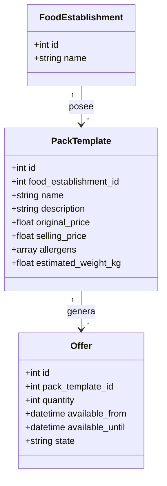
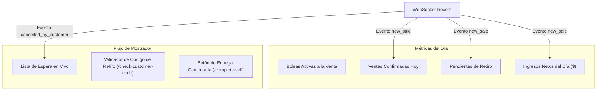

# Explicación: Dashboard Operativo de Vendedor y Plantillas de Packs

> **Tipo**: Explicación / Arquitectura (Diátaxis)  
> **Objetivo**: Justificar el diseño de la consola de operaciones en tiempo real para comercios gastronómicos y el patrón de plantillas reutilizables (`PackTemplate`) para eliminar la fricción en la publicación diaria de excedentes.

---

## 1. La Realidad Operativa del Comerciante Gastronómico

En panaderías, restaurantes, verdulerías y rotiserías, el trabajo diario es intenso y contrarreloj. Al finalizar la jornada o al promediar la tarde:
* El personal de cocina o mostrador solo dispone de **2 a 3 minutos** para estimar qué excedentes no se venderán a precio regular.
* Forzar al encargado a redactar desde cero cada día el título, descripción detallada, alérgenos, precio original y precio con descuento desincentiva el uso de la plataforma.
* Durante la franja de retiro (por ejemplo, 20:00 a 21:00 hs), el mostrador atiende clientes regulares y rescatadores simultáneamente, necesitando una **herramienta ultrarrápida para validar entregas**.

Para resolver esta dinámica operativa, Tatelestai implementa dos componentes clave:
1. **Plantillas de Packs Reutilizables (`PackTemplate`)**.
2. **Dashboard Operativo en Tiempo Real (`SellerDashboardController`)**.

---

## 2. Patrón de Plantillas de Packs (`PackTemplate`)

La plantilla actúa como un molde preconfigurado que almacena la información estática del producto, separándola de los parámetros variables de la jornada.

### Separación de Responsabilidades:
* **Parámetros Estáticos (en la Plantilla)**:
  - Nombre del pack (ej. *"Pack Medialunas y Facturas del Día"*).
  - Descripción y tipo de alimentos contenidos.
  - Alérgenos declarados (TACC, Frutos secos, Lactosa, etc.).
  - Precio original de lista y precio de rescate con descuento (mínimo 50% de ahorro).
  - Peso o volumen estimado en kilogramos.
* **Parámetros Dinámicos (al publicar la Oferta del día)**:
  - Cantidad disponible de bolsas para hoy (`quantity`, ej. 3 unidades).
  - Franja horaria estricta de retiro (`available_from` y `available_until`, ej. 19:30 a 20:30 hs).

### Flujo de Publicación en 1 Clic:
Con un solo toque en la app, el comerciante selecciona su plantilla guardada, ingresa el stock del día y la oferta queda automáticamente activa y visible para los clientes geolocalizados en el mapa.

---

## 3. Arquitectura del Dashboard Operativo en Tiempo Real

El endpoint `GET /api/seller/dashboard` provee una vista sintética y consolidada de la jornada actual:

### Indicadores Principales:
1. **Bolsas Activas**: Conteo de ofertas en estado `OfferState::ACTIVE` con stock disponible.
2. **Ventas Confirmadas**: Número de pedidos que han completado el pago en Mercado Pago hoy (`SellState::READY` o `CONFIRMED`).
3. **Pendientes de Retiro**: Compradores que tienen programado retirar su paquete antes del cierre de la franja horaria.
4. **Liquidación Neta Acumulada**: Monto total a cobrar descontada la comisión de plataforma.

---

## 4. Validación de Retiros en Mostrador

Para prevenir entregas indebidas o fraudes, el proceso de entrega en el local sigue una verificación criptográfica de dos factores en el sistema:

1. **Código Alfanumérico Único**: Al pagar, el cliente recibe un código de retiro de 6 caracteres generado por `GeneratePickupCodeAction` (ej. `TL-8F92`).
2. **Comprobación en Dashboard (`POST /check-customer-code`)**: El vendedor introduce el código en su pantalla táctil o escanea el QR.
3. **Cierre Atómico de la Venta (`POST /complete-sell/{sellNumber}`)**:
   - La orden pasa a `SellState::PICKED_UP`.
   - Se emite el evento en tiempo real `order_picked_up` al comprador.
   - Se habilita automáticamente la ventana de 14 días para que el cliente califique el local.
