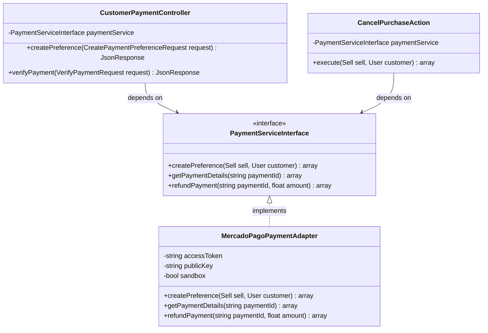
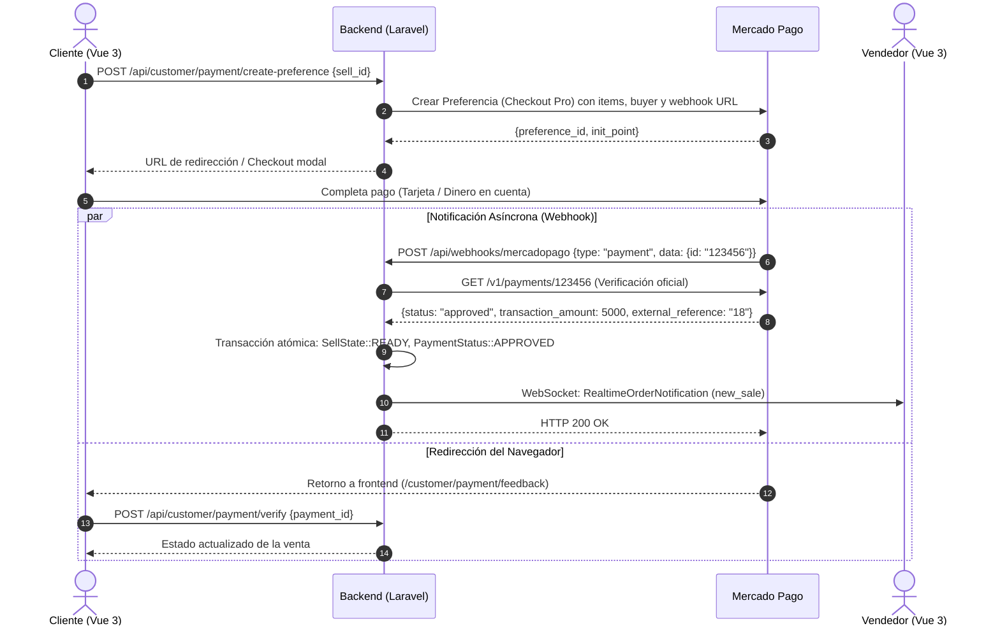

# Explicación: Integración de Pagos con Mercado Pago Checkout Pro

> **Tipo**: Explicación / Arquitectura (Diátaxis)  
> **Objetivo**: Detallar el diseño de la pasarela de pagos, el desacoplamiento mediante el patrón Adapter, la gestión de comisiones de plataforma, la idempotencia de webhooks y la automatización de reembolsos.

---

## 1. Modelo de Negocio y Flujo Financiero

Tatelestai opera bajo un modelo de **marketplace gastronómico de doble cara**:
1. El **Comprador (Customer)** reserva y abona las bolsas sorpresa a través de una experiencia de checkout segura y reconocida.
2. La **Plataforma (Tatelestai)** retiene una comisión por servicio sobre el valor bruto de la venta.
3. El **Comercio (Food Establishment)** recibe la liquidación neta una vez concretada la entrega.
4. En caso de cancelación justificada dentro de los plazos establecidos, la plataforma garantiza el **reembolso automático** de los fondos al medio de pago original del comprador.

---

## 2. Arquitectura de Desacoplamiento: Patrón Adapter

Para evitar que el dominio de Tatelestai quede atado al SDK o a los cambios de API de un proveedor específico, se implementó el **Patrón Adapter (Puertos y Adaptadores)**:



### Contrato de la Interfaz (`PaymentServiceInterface`):
* `createPreference(Sell $sell, User $customer)`: Genera la orden de cobro y devuelve los enlaces `init_point` y `sandbox_init_point`.
* `getPaymentDetails(string $paymentId)`: Consulta el estado oficial del pago en los servidores de la pasarela.
* `refundPayment(string $paymentId, ?float $amount)`: Ejecuta la devolución total o parcial de fondos.

Gracias a este diseño, si en el futuro se incorpora Stripe u otra pasarela regional, basta con crear una nueva clase adaptadora sin alterar los controladores ni las acciones de dominio.

---

## 3. Máquina de Estados de Pago y Venta

La compra transita por dos dimensiones de estado coordinadas: el estado operacional de la orden (`SellState`) y el estado financiero de la transacción (`PaymentStatus`).

```mermaid
stateDiagram-v2
    [*] --> PENDING_PAYMENT: Customer reserva carrito<br/>(SellState::PENDING, PaymentStatus::PENDING)
    
    PENDING_PAYMENT --> PAID_AND_READY: Webhook / Verify confirma cobro aprobado<br/>(SellState::READY, PaymentStatus::APPROVED)
    
    PENDING_PAYMENT --> PAYMENT_FAILED: Rechazo de pago o timeout<br/>(SellState::CANCELLED, PaymentStatus::REJECTED)
    
    PAID_AND_READY --> COMPLETED: Retiro con código en local<br/>(SellState::PICKED_UP, PaymentStatus::APPROVED)
    
    PAID_AND_READY --> REFUNDED: Cancelación por cliente o comercio<br/>(SellState::CANCELLED, PaymentStatus::REFUNDED)
```

---

## 4. Diagrama de Secuencia: Checkout Pro y Webhooks

El siguiente flujo describe el ciclo de vida completo desde que el comprador decide pagar hasta que el comercio es notificado:



---

## 5. Garantías de Idempotencia en el Webhook

Mercado Pago puede reintentar el envío de webhooks múltiples veces si su servidor no recibe una respuesta `HTTP 200` en menos de unos pocos segundos, o ante microcortes de red.

Para prevenir la doble confirmación o condiciones de carrera, el endpoint `POST /api/webhooks/mercadopago` implementa **idempotencia estricta**:
1. **Verificación contra la API de Mercado Pago**: No se confía en el cuerpo del webhook recibido; el backend consulta directamente la API oficial de Mercado Pago usando el `paymentId` para obtener el estado real e inalterable.
2. **Bloqueo Pesimista en Base de Datos**:
   ```php
   $sell = Sell::where('id', $externalReference)->lockForUpdate()->first();
   ```
3. **Guardas de Estado**: Si la venta ya se encuentra en `SellState::READY` y su `payment_status` es `approved`, el webhook responde inmediatamente `HTTP 200` sin repetir mutaciones de inventario ni despachar alertas duplicadas.

---

## 6. Modelo de Comisiones de Plataforma

La plataforma aplica una comisión porcentual configurable mediante la variable de entorno `TATELESTAI_COMMISSION_PERCENTAGE` (por defecto `15.0%`).

### Cálculo Financiero:
Sea $T$ el importe total pagado por el cliente y $C_{\%}$ el porcentaje de comisión:

$$\text{Comisión Tatelestai} = T \times \left(\frac{C_{\%}}{100}\right)$$

$$\text{Liquidación Vendedor (Neto)} = T - \text{Comisión Tatelestai}$$

#### Ejemplo Numérico:
* Pack Sorpresa: \$4.000 ARS.
* Comisión Tatelestai (15%): \$600 ARS.
* Liquidación neta al local gastronómico: \$3.400 ARS.

Estos valores quedan registrados en el modelo `Sell` y son reflejados en el **Dashboard de Vendedor**, garantizando absoluta transparencia contable.

---

## 7. Automatización de Cancelaciones y Reembolsos

Cuando una orden confirmada es cancelada (por el cliente dentro de los plazos permitidos o por el comercio mediante `SellerCancelSellAction`):
1. **Arbitraje de Política (`PurchaseCancellationPolicy`)**: Se valida que la venta se encuentre en un estado reembolsable (`ready` o `confirmed`) y dentro del horario autorizado.
2. **Llamada a la API de Reembolso**:
   ```php
   if ($sell->payment_id) {
       $this->paymentService->refundPayment($sell->payment_id);
   }
   ```
3. **Transición Atómica**: La venta pasa a `SellState::CANCELLED` y `PaymentStatus::REFUNDED`, registrando la marca de tiempo `refunded_at`.
4. **Restitución Atómica de Stock**: Las unidades de la bolsa sorpresa regresan inmediatamente al inventario disponible del comercio (`RestoreOfferStockAction`).
5. **Notificación en Tiempo Real**: Se emite la alerta correspondiente por WebSocket al usuario opuesto (`cancelled_by_customer` o `cancelled_by_seller`).
