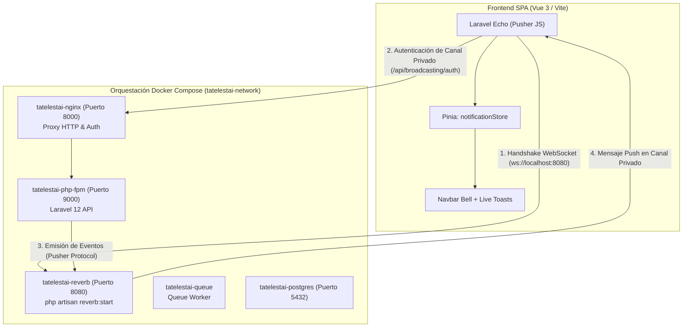
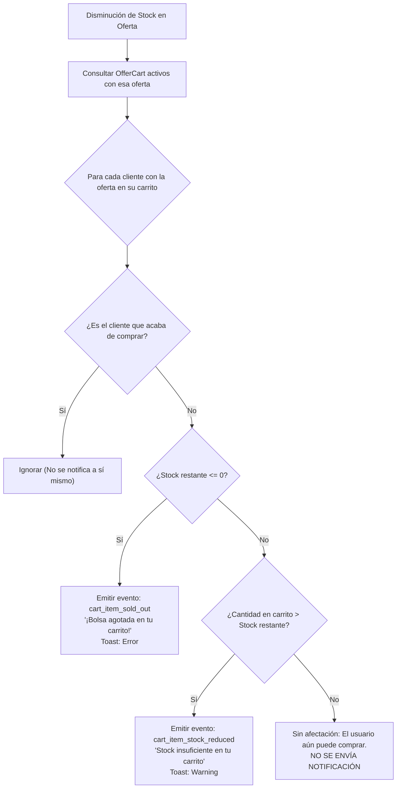

# Explicación: Notificaciones en Tiempo Real y Arquitectura WebSocket

> **Tipo**: Explicación / Arquitectura (Diátaxis)  
> **Objetivo**: Fundamentar el diseño del sistema de eventos en tiempo real, la integración de Laravel Reverb y Laravel Echo, y el modelo quirúrgico de alertas privadas para control de carritos y pedidos sin recurrir a broadcastings masivos ruidosos.

---

## 1. Motivación y Desafíos del Dominio

En una plataforma de rescate gastronómico como **Tatelestai**, la frescura de los datos es un requisito de misión crítica:
1. Las bolsas sorpresa (*packs*) cuentan con **stock muy limitado** (frecuentemente 1 a 3 unidades por comercio).
2. Las ventanas de retiro son estrictas y acotadas (por ejemplo, entre las 20:00 y las 21:00 hs).
3. Múltiples compradores pueden tener la misma bolsa sorpresa en su carrito simultáneamente.

El enfoque tradicional basado en sondeo periódico (*HTTP polling*) presenta dos graves inconvenientes:
* **Sobrecarga de infraestructura**: Cientos de clientes realizando peticiones cada 5 segundos saturan la base de datos y los workers PHP con lecturas redundantes donde el 99% de las veces no hubo cambios.
* **Degradación de experiencia móvil**: El polling constante agota la batería de los dispositivos y genera consumo innecesario de datos móviles.

Por estas razones, Tatelestai adopta una arquitectura bidireccional basada en **WebSockets**, combinando **Laravel Reverb** en el backend y **Laravel Echo** en el frontend.

---

## 2. Infraestructura: Laravel Reverb en Docker

Laravel Reverb es un servidor WebSocket de alto rendimiento escrito en PHP nativo, compatible con el protocolo Pusher. A diferencia de soluciones de terceros que requieren pagar por suscripciones en la nube o intermediarios en Node.js (como Socket.io), Reverb corre localmente como un servicio de primera clase en la orquestación Docker de Tatelestai.



### Características de la Configuración:
* **Contenedor Dedicado**: `tatelestai-reverb` expone el puerto `8080` al host y corre bajo supervisión continua.
* **Canal de Emisión Directa**: Las acciones de Laravel emiten los eventos a Reverb vía socket TCP interno (`reverb:8080`), y Reverb los despacha instantáneamente a los clientes web conectados.
* **Autenticación con Sanctum**: Reverb delega la autorización de los canales en la API HTTP principal mediante la ruta de broadcast (`/broadcasting/auth`).

---

## 3. Estrategia de Canales: Fin del Broadcast Masivo vs. Canales Privados

### El Problema del Broadcast Masivo (`offers` channel)
En iteraciones tempranas, la plataforma consideró un canal público `offers` al que se suscribían todos los clientes conectados, emitiendo un evento masivo `OfferStockUpdated` cada vez que cualquier compra modificaba el stock.

Este modelo fue descartado por los siguientes motivos arquitectónicos y de experiencia de usuario:
1. **Contaminación de red y latencia**: En horas pico con miles de visitas, un establecimiento vendiendo sus 3 bolsas provocaba que cientos de teléfonos que navegaban el catálogo recibieran eventos que no les interesaban.
2. **Efecto visual disruptivo**: En el catálogo, las tarjetas desaparecían o cambiaban bruscamente frente a los ojos del comprador mientras leía su descripción.
3. **Fugas de privacidad de volumen de negocio**: Un canal público transmitiendo cada venta permite a competidores deducir el volumen exacto de transacciones de un comercio.

### La Solución: Canales Privados y Quirúrgicos (`private-App.Models.User.{id}`)
Cada usuario autenticado (sea cliente o vendedor) se suscribe exclusivamente a su propio canal privado:
$$\text{Canal: } \texttt{private-App.Models.User.}id$$

Solo se emite un evento si el usuario tiene un **interés legítimo y directo** en la transacción.

---

## 4. Algoritmo de Detección de Disrupción en Carritos

Cuando una compra se completa exitosamente en `makeSellAction`, o cuando un vendedor modifica manualmente la disponibilidad de una oferta, se ejecuta la acción de dominio `NotifyCartStockDisruptionAction`.

Esta acción no envía una señal genérica a toda la base de datos; inspecciona quirúrgicamente los carritos activos (`UserCart` en estado `CartState::ACTIVE`) que contienen la oferta afectada y aplica la siguiente matriz de decisión:



### Reglas Matemáticas del Algoritmo:
Sea $Q_{\text{rem}}$ el stock disponible de la oferta tras la operación y $Q_{\text{cart}}$ la cantidad que el cliente tiene en su carrito:
1. **Caso 1: Agotamiento Total ($Q_{\text{rem}} \le 0$)**:
   Se notifica `cart_item_sold_out`. El cliente ya no podrá adquirir el producto y debe liberar el carrito.
2. **Caso 2: Stock Parcial Insuficiente ($Q_{\text{cart}} > Q_{\text{rem}} > 0$)**:
   Se notifica `cart_item_stock_reduced`. El cliente aún puede comprar, pero debe ajustar la cantidad hacia abajo para poder finalizar la orden.
3. **Caso 3: Stock Remanente Suficiente ($Q_{\text{cart}} \le Q_{\text{rem}}$)**:
   **Cero notificación**. El cliente conserva su capacidad de compra intacta. No se satura su interfaz con avisos innecesarios.

---

## 5. Taxonomía de Eventos en Tiempo Real

Todos los eventos de orden y carrito se encapsulan en la notificación unificada `App\Notifications\RealtimeOrderNotification`, la cual se almacena en base de datos (`database`) y se emite simultáneamente por WebSocket (`broadcast` con `BroadcastMessage`):

| Evento (`eventType`) | Destinatario | Disparador | Acción en Frontend |
|---|---|---|---|
| `new_sale` | Vendedor | Cliente confirma compra y pago | Incrementa contador de ventas del día, suena alerta sonora, actualiza Dashboard de vendedor. |
| `cancelled_by_customer` | Vendedor | Cliente cancela su reserva dentro del plazo | Notifica liberación de stock y actualiza panel de pedidos pendientes. |
| `offer_sold_out` | Vendedor | El stock de su oferta llegó a cero | Avisa al local que ha liquidado la totalidad de sus bolsas disponibles. |
| `order_picked_up` | Comprador | Vendedor valida el código de retiro en local | Muestra confirmación de entrega exitosa y habilita modal para calificar el comercio. |
| `cancelled_by_seller` | Comprador | Vendedor cancela por imprevisto de fuerza mayor | Alerta sobre la cancelación y el inicio automático del reembolso en Mercado Pago. |
| `cart_item_sold_out` | Comprador | Otro cliente compró las últimas bolsas disponibles | Toast de error, marca ítem no disponible en vista de carrito. |
| `cart_item_stock_reduced` | Comprador | El stock bajó por debajo de lo reservado en carrito | Toast de advertencia, actualiza selector de cantidad del carrito. |

---

## 6. Integración en Frontend (Vue 3 y Pinia)

El cliente web implementa la sincronización mediante el store centralizado `useNotificationStore`:

```javascript
// src/stores/notifications.js
echo.private(`App.Models.User.${userId}`)
    .notification((notification) => {
        // 1. Agregar a la bandeja de notificaciones no leídas
        notifications.value.unshift(notification);
        unreadCount.value++;

        // 2. Disparar Toast visual no invasivo con estilo acorde a la severidad
        toastStore.show({
            title: notification.title,
            message: notification.message,
            type: resolveToastType(notification.eventType),
            actionUrl: notification.actionUrl,
        });

        // 3. Reactividad en vistas específicas (ej. CustomerCart o SellerDashboard)
        lastOrderEvent.value = notification;
    });
```

### Componentes Reactivos Clave:
* **Navbar Bell**: Muestra un badge numérico animado con el conteo de notificaciones no leídas (`unreadCount`).
* **CustomerCart**: Escucha `lastOrderEvent`; si el evento corresponde a `cart_item_sold_out` o `cart_item_stock_reduced`, refresca silenciosamente el carrito mediante `getCart()` sin reiniciar la página.
* **SellerDashboard**: Escucha `lastOrderEvent`; si recibe `new_sale`, suma el monto a los ingresos del día y agrega la orden a la lista de retiros pendientes en tiempo real.
