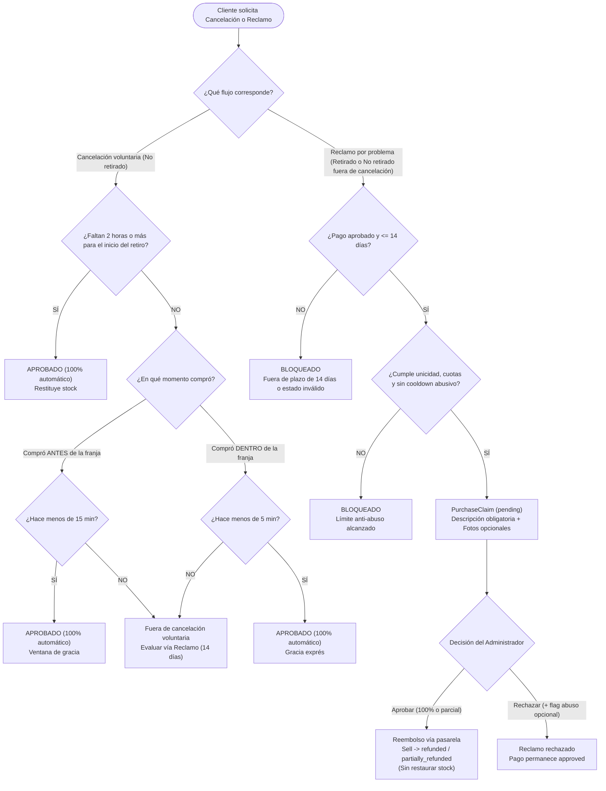

# Explicación: Políticas de Cancelación y Reembolsos

> **Tipo**: Explicación / Reglas de Dominio (Diátaxis)  
> **Objetivo**: Especificar de forma aislada y rigurosa las políticas, ventanas de corte y árbol de decisión para cancelaciones voluntarias, incomparecencias y reembolsos en Tatelestai.  
> **Documentos Relacionados**: [Lógica de Negocio de Packs Sorpresa](./logica-negocio-packs-sorpresa.md) · [Lógica de Dominio y Reglas Generales](./logica-de-negocio-y-reglas.md) · [ADR-0001: Bloqueo Pesimista](./adrs/0001-bloqueo-pesimista-para-control-de-stock.md)

---

## 1. Propósito

Este documento delimita formalmente **cuándo, por qué y cómo** se aprueba o rechaza una solicitud de reembolso monetario en Tatelestai, protegiendo tanto la experiencia del consumidor como la viabilidad económica de los establecimientos gastronómicos adheridos.

---

## 2. Árbol de Decisión: Cancelación Voluntaria vs. Reclamo de Compra

El siguiente diagrama distingue entre la **cancelación voluntaria inmediata** (sujeta a ventanas horarias pre-retiro) y el **reclamo de compra (`PurchaseClaim`)** (desacoplado de las restricciones horarias previas, con un plazo de hasta **14 días** y moderación administrativa):

---

## 3. Matriz Normativa de Reembolsos

| Escenario | Momento del Evento | Condición de Aprobación | ¿Reembolso? | Destino del Stock |
|---|---|---|:---:|---|
| **Cancelación con anticipación** | Pre-retiro | Solicitada con **>= 2 horas** de anticipación al inicio de la franja. | **100%** | Se reintegra al inventario (`Offer.quantity + N`) y se reindexa en Typesense. |
| **Gracia por compra reciente (Pre-franja)** | Pre-retiro | Compra realizada antes de la franja; cancelación dentro de los primeros **15 minutos**. | **100%** | Se reintegra al inventario para venta inmediata. |
| **Gracia exprés (Intra-franja)** | Pre-retiro | Compra realizada durante el horario en curso; cancelación dentro de los primeros **5 minutos**. | **100%** | Se libera el cupo para compra presencial o en app. |
| **Cancelación por el Comercio** | Pre-retiro | Comercio sin merma suficiente o fuerza mayor (cierre imprevisto). | **100%** | N/A (Oferta pausada). Notificación automática inmediata al cliente. |
| **Reclamo por calidad, faltantes, alérgenos o incidencia en retiro** | Post-retiro o Pre-retiro fuera de plazo de cancelación | Compra pagada (`approved`), estado permitido (`picked_up`, `pending`, `confirmed`, `ready`, `expired`), dentro de **14 días corridos**, descripción obligatoria, fotos opcionales y aprobación de Administrador. | **Total o Parcial** (a criterio del Admin) | **No se restaura stock** ni se altera `Sell.state`; impacta métricas financieras del vendedor. |
| **Incomparecencia (*No-Show*) injustificada** | Post-franja | El comprador no retira el pedido sin causa atribuible al comercio; sujeto a cuota estricta (máx. 1 reclamo no retirado cada 60 días) y revisión Admin. | **0% por defecto** (excepcional si Admin aprueba) | No se restituye stock. |
| **Reclamo Extemporáneo o Abusivo** | > 14 días o abuso reiterado | Reporte iniciado luego de **14 días** o bloqueado por cuotas / marca `is_abusive`. | **0%** | No admite reclamo (`HTTP 422`). |

---

## 4. Detalle de Reglas de Negocio

### 4.1. Cancelación Voluntaria Pre-Retiro
1. **Regla de las 2 Horas**: Permite al marketplace disponer de una ventana operativa mínima para alertar a otros comensales cercanos e incentivar el rescate del alimento antes de que el local concluya su turno.
2. **Ventana de Gracia Diferenciada**:
   * **15 minutos (Compras antes de la franja)**: Protege ante clics accidentales, selección errónea de sucursal o equivocación en el método de pago con tiempo suficiente previo al retiro.
   * **5 minutos (Compras dentro de la franja en curso)**: Si el usuario compra de último momento (ej. caminando frente al local a horario de retiro iniciado), el tiempo es crítico. Se reduce a 5 minutos el margen para corregir errores, impidiendo que una orden quede bloqueada durante el cierre del local.

### 4.2. Reclamos de Compra (`PurchaseClaim`) sin Restricción Horaria de Cancelación
* **Desacoplamiento horario y plazo máximo de 14 días**: Una compra pagada (`PaymentStatus::APPROVED`) puede reclamarse hasta **14 días corridos** desde el retiro (`picked_up_at`, o `created_at` en su defecto) o desde el cierre de la ventana de retiro (`max_pickup_datetime`, o `created_at`) si no fue retirada —sin exigir las reglas de 2 horas, 15 minutos o 5 minutos.
* **No superposición con cancelación en término**: Si una compra aún no fue retirada y todavía califica para cancelación voluntaria inmediata (`PurchaseCancellationPolicy`), el sistema indica utilizar la cancelación directa en lugar de iniciar moderación administrativa.
* **Motivos tipificados**: `spoiled_food` (comida en mal estado), `not_as_described` (distinto a lo publicado), `undeclared_allergen` (presencia de alérgeno declarado como ausente), `missing_items` (faltantes), `pickup_issue` (problema atribuible al retiro/local) u `other`.
* **Evidencia y snapshot inmutable**: La descripción del problema es obligatoria (10 a 1000 caracteres) y las fotos son **opcionales** (hasta 5 imágenes almacenadas en disco `private`). Además, `sell_details` congela al momento de compra los alérgenos declarados, peso estimado, valor mínimo, título, descripción y precio para auditoría imparcial aunque la oferta cambie o se elimine luego.
* **Resolución por Administrador**: Un administrador evalúa el reclamo junto al *snapshot* de la compra, las evidencias y las señales de riesgo del comprador, pudiendo aprobar un **reembolso total (`refunded`) o parcial (`partially_refunded`)** ejecutado en la pasarela de pagos, o rechazarlo con nota obligatoria.

### 4.3. Controles Anti-Abuso
Para evitar el uso oportunista de reclamos (especialmente ante incomparecencias):
1. **Un único reclamo por compra**: restricción única por `sell_id`.
2. **Cuotas configurables (`config/claims.php`)**: máximo `2` reclamos abiertos simultáneos, máximo `3` reclamos en los últimos `30` días, y límite estricto de `1` reclamo sobre compras no retiradas en `60` días.
3. **Bloqueo por abuso (`is_abusive`)**: si un administrador marca un reclamo rechazado como abusivo, el comprador queda restringido por `30` días para iniciar nuevos reclamos.

---

## 5. Implementación en Backend (Laravel)

### 5.1. Transición de Estados en `Sell`
* **Cancelación voluntaria o por comercio pre-retiro**:
  1. `Sell.state` muta a `SellState::CANCELLED` y `payment_status` a `PaymentStatus::REFUNDED` con `refunded_amount = gross_amount`.
  2. El `pickup_code` queda inmediatamente revocado.
  3. El stock de la oferta se restituye atómicamente vía `RestoreOfferStockAction`.
* **Aprobación de un reclamo (`ResolvePurchaseClaimAction`)**:
  1. `Sell.payment_status` pasa a `PaymentStatus::REFUNDED` (reembolso total) o `PaymentStatus::PARTIALLY_REFUNDED` (reembolso parcial), registrando `refunded_amount` y `refunded_at`.
  2. **`Sell.state` no se modifica** (preserva `picked_up`, `expired`, etc.) y **no se restaura stock**, evitando reingresar alimentos ya entregados o vencidos.
  3. Las métricas financieras (`GetSellerDashboardStatsAction`, `SellerSellController`, `SellController`, vistas de historial/ventas) descuentan `refunded_amount` del monto bruto efectivo y recalculan comisión y neto proporcionales.

### 5.2. Liquidación y Pasarela de Pagos
* Se invoca `PaymentServiceInterface::refundPayment()` sobre el `payment_id` de Mercado Pago (total con `amount = null` o parcial con el monto aprobado).
* En reclamos aprobados por Administración, cualquier fallo de la pasarela revierte la transacción DB y devuelve error `HTTP 502` sin mutar el estado del reclamo ni de la venta, garantizando reintentos seguros e idempotentes.
