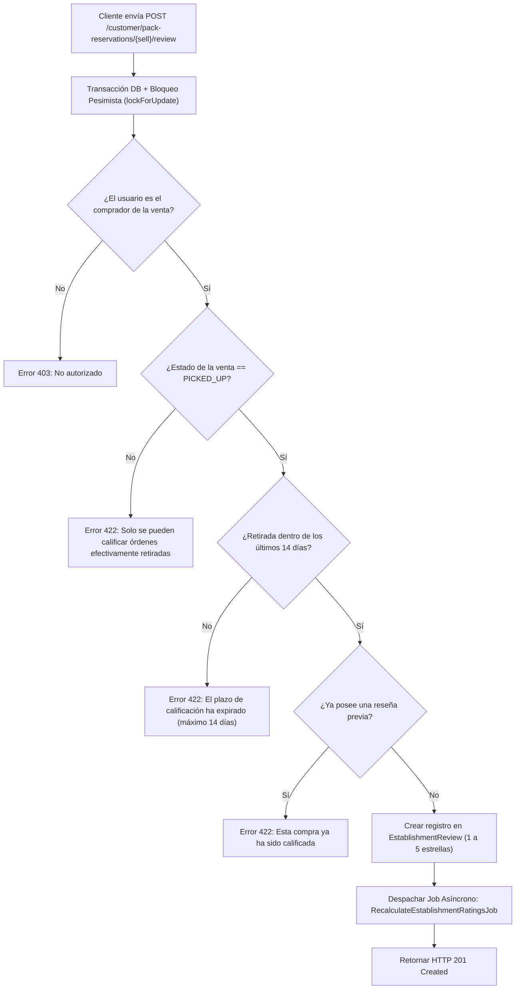
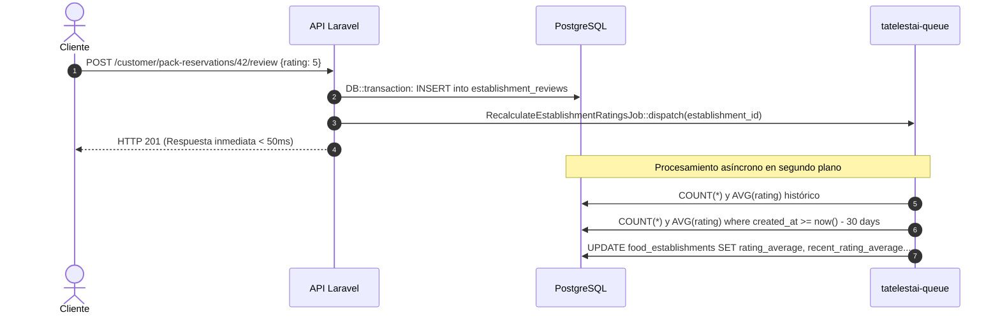

# Explicación: Reputación y Sistema de Calificaciones de Doble Media

> **Tipo**: Explicación / Arquitectura (Diátaxis)  
> **Objetivo**: Fundamentar el modelo de reputación de establecimientos gastronómicos, las políticas anti-fraude post-retiro y el algoritmo matemático de doble media (histórica y reciente).

---

## 1. El Problema de las Reseñas en Gastronomía de Descarte

En plataformas gastronómicas tradicionales, los sistemas de calificación presentan dos grandes patologías:
1. **Reseñas Falsas o No Verificadas**: Usuarios que califican locales en los que nunca consumieron, distorsionando la reputación real con fines malintencionados o de autopromoción.
2. **Efecto Anclaje Histórico**: Un restaurante que tuvo un mal inicio pero mejoró drásticamente sus procesos de envasado y calidad de excedentes queda "anclado" a un promedio bajo de por vida. Inversamente, un local históricamente excelente que ha decaído en el último mes sigue exhibiendo 5 estrellas basadas en cientos de opiniones de años anteriores.

Para resolver estos problemas, Tatelestai adopta una arquitectura basada en **Calificaciones Estrictamente Verificadas Post-Retiro** y un **Algoritmo de Doble Media de Reputación**.

---

## 2. Reglas de Negocio y Políticas Anti-Fraude

El registro de una reseña no es un endpoint libre; está fuertemente acoplado a la máquina de estados de la venta y custodiado por la política de autorización `SellReviewPolicy`:



### Principios Fundamentales:
* **Condición Sine Qua Non de Retiro (`SellState::PICKED_UP`)**: Imposible calificar pedidos cancelados, pendientes o expirados. Solo quien retiró la comida puede evaluarla.
* **Ventana Temporal Acotada (14 días)**: La memoria sensorial y la percepción de frescura de un alimento se degradan rápidamente. Transcurridas dos semanas, no se admiten reseñas extemporáneas.
* **Unicidad e Idempotencia**: Cada orden admite exactamente una valoración, previniendo condiciones de carrera mediante transacción atómica y bloqueo pesimista en base de datos.

---

## 3. Algoritmo Matemático: Doble Media de Reputación

En lugar de almacenar un único promedio simple, el modelo de datos de `FoodEstablishment` persiste dos dimensiones estadísticas complementarias:

### A. Media Histórica ($M_H$)
Representa la consistencia y la solidez global del comercio desde su incorporación a la plataforma.

$$M_H = \frac{1}{N} \sum_{i=1}^{N} R_i \quad \text{donde } R_i \in \{1, 2, 3, 4, 5\}$$

* $N$: Total acumulado de reseñas de por vida (`reviews_count`).
* Si $N = 0$, $M_H = \text{null}$ (mostrando estado *"Nuevo"* o *"Sin calificaciones suficientes"*).

### B. Media Reciente ($M_R$ - Ventana Móvil de 30 Días)
Captura la calidad del servicio, la frescura de los alimentos y la puntualidad operativa del **último mes de actividad**.

$$M_R = \frac{1}{M} \sum_{j \in \text{Últimos 30d}} R_j$$

* $M$: Cantidad de reseñas emitidas con $\text{created\_at} \ge \text{now}() - 30\text{ días}$ (`recent_reviews_count`).
* Si $M = 0$, el frontend recurre con elegancia al promedio histórico.

### Comparativa de Impacto:

| Escenario | Media Histórica ($M_H$) | Media Reciente ($M_R$) | Interpretación para el Usuario |
|---|---|---|---|
| Comercio nuevo con 5 pedidos | 4.80 (5 reseñas) | 4.80 (5 reseñas) | Excelente debut en la plataforma. |
| Comercio veterano que bajó la calidad | 4.60 (300 reseñas) | **3.20** (12 reseñas) | Alerta: El servicio reciente no refleja su prestigio pasado. |
| Comercio reformado con nueva gestión | 3.40 (150 reseñas) | **4.90** (25 reseñas) | Reconocimiento: Marcada mejora en sus entregas actuales. |

---

## 4. Desacoplamiento y Recálculo Asíncrono

El cálculo de promedios no se ejecuta dentro de la petición HTTP del usuario para evitar bloqueos y penalizaciones en el tiempo de respuesta.



El worker de colas (`tatelestai-queue`) procesa el job de forma segura y consistente, garantizando que el perfil del comercio y las tarjetas del catálogo se sincronicen en milisegundos.

---

## 5. Exposición en el Frontend

El recurso de API `EstablishmentRatingSummaryResource` expone la información consolidada al cliente Vue 3:

```json
{
  "rating_average": 4.65,
  "reviews_count": 84,
  "recent_rating_average": 4.90,
  "recent_reviews_count": 18,
  "stars_distribution": {
    "5": 60,
    "4": 18,
    "3": 4,
    "2": 1,
    "1": 1
  }
}
```

En la interfaz de usuario, las tarjetas del catálogo muestran visualmente las estrellas doradas y, al desplegar el detalle, destacan la insignia **"Último mes: 4.9 ★"**, otorgando al consumidor una señal transparente y de alta fidelidad antes de reservar.
