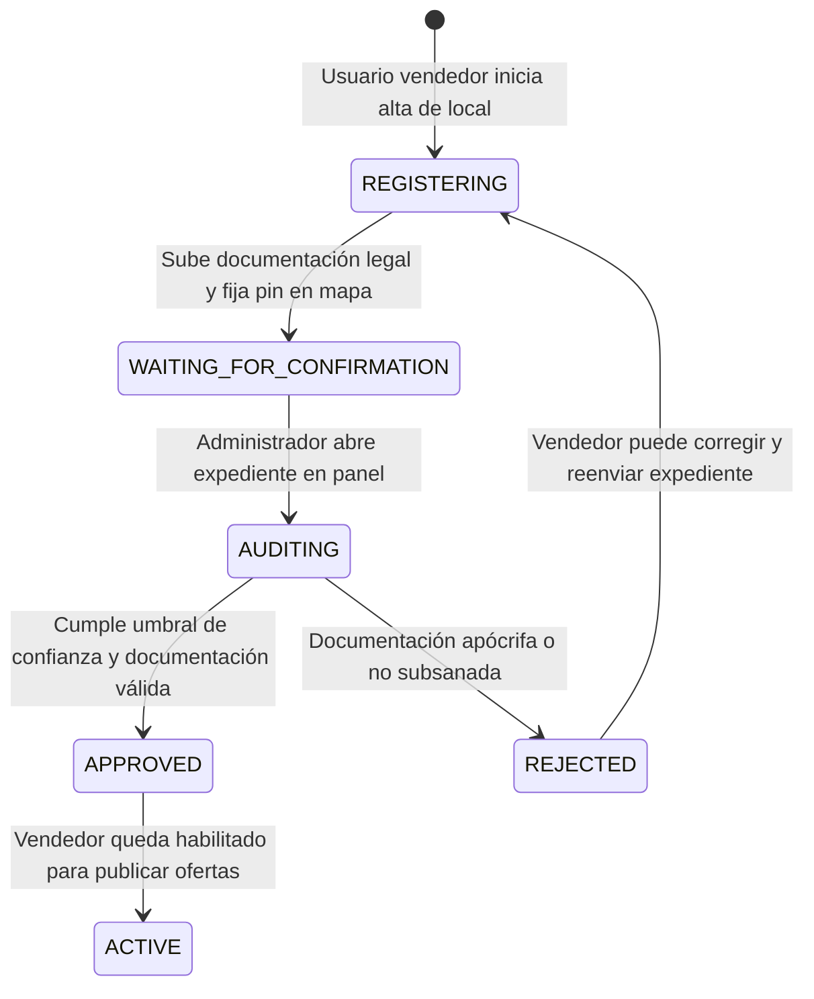
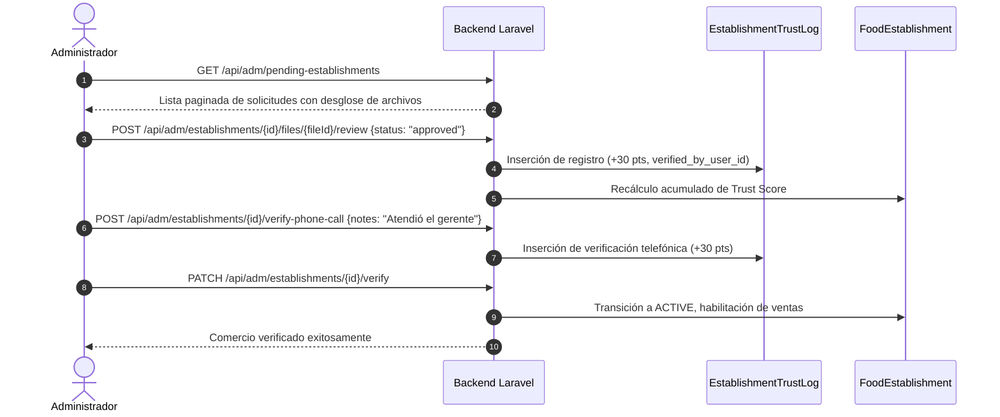

# Explicación: Verificación de Comercios y Ledger de Trust Score

> **Tipo**: Explicación / Arquitectura (Diátaxis)  
> **Objetivo**: Documentar el modelo de seguridad alimentaria, el flujo de auditoría administrativa y el diseño del ledger inmutable de Trust Score para establecimientos gastronómicos.

---

## 1. Contexto de Misión Crítica: Seguridad y Confianza Alimentaria

En una plataforma de rescate de excedentes gastronómicos, permitir que un comercio opere sin comprobación legal previa representa riesgos inaceptables:
* **Riesgo Sanitario**: Consumo de alimentos manipulados en locales sin habilitación bromatológica o sin controles de plagas vigentes.
* **Fraude Comercial**: Entidades ficticias que publican ofertas con fines de estafa sin tener un local físico para el retiro.
* **Fricción Operativa**: Clientes que viajan hasta una dirección inexistente porque las coordenadas del local fueron mal geocodificadas.

Tatelestai mitiga estos riesgos mediante un **Proceso de Verificación de Múltiples Criterios** y un **Ledger Inmutable de Trust Score (Puntaje de Confianza)**.

---

## 2. Ciclo de Vida del Registro de un Establecimiento

El registro de un comercio no activa automáticamente al vendedor; atraviesa un pipeline riguroso:

### Hitos del Registro:
1. **Geolocalización Asistida y Manual**: El comercio puede buscar su dirección vía autocompletado de Google Places o ajustar manualmente el pin en el mapa satelital para asegurar coordenadas de latitud y longitud exactas.
2. **Carga de Documentación Probatoria**: Subida de archivos (`EstablishmentVerificationFile`) en formatos PDF, JPG o PNG.
3. **Auditoría con Soft Deletes**: Si un documento es rechazado o reemplazado, no se elimina físicamente de la base de datos; se utiliza borrado lógico (*soft delete*) para conservar la trazabilidad histórica de todo archivo presentado.

---

## 3. Arquitectura del Ledger de Trust Score

### ¿Por qué un Ledger y no un campo entero simple?
Un diseño ingenuo almacenaría una simple columna `trust_score = 80` en la tabla de comercios. Sin embargo, en auditorías legales y reclamos comerciales, es imperativo responder: *¿Quién aprobó la habilitación? ¿En qué fecha? ¿Por qué se le otorgaron esos puntos?*

Por ello, Tatelestai adopta el **Patrón Ledger (Libro Mayor)** mediante el modelo `EstablishmentTrustLog`:
* Cada evento de puntaje es una fila individual inmutable.
* El puntaje total del comercio es la suma agregada de sus entradas activas:

$$\text{Trust Score} = \sum \text{points} \quad \text{donde } \texttt{is\_active} = \text{true}$$

---

## 4. Matriz de Ponderación por Criterio (`TrustScoreCriterion`)

Cada documento o verificación física aporta una cantidad de puntos estandarizada en el enum de dominio `TrustScoreCriterion`:

| Criterio (`source_type`) | Puntos | Entidad Emisora / Validación | Objetivo Probatorio |
|---|---|---|---|
| `tax_certificate` | **+30** | ARCA / AFIP | Constancia de CUIT e inscripción tributaria formal. |
| `municipal_permit` | **+30** | Municipalidad local | Habilitación comercial u Oblea bromatológica de expendio. |
| `municipal_tax_receipt` | **+30** | Organismo de recaudación (ARMSa/TISSH) | Boleta de pago de tasa comercial que prueba actividad actual. |
| `phone_call_verification` | **+30** | Operador Tatelestai | Llamada telefónica de control al número comercial declarado. |
| `pest_control_certificate` | **+20** | Empresa certificada de saneamiento | Certificado vigente de desinfección y control de plagas. |
| `google_places_profile` | **+20** | API de Google / Ficha pública | Coincidencia de ficha comercial pública en Google Maps. |
| `store_counter_photo` | **+10** | Fotografía propia | Foto del mostrador o cocina interior del establecimiento. |
| `facade_photo` | **+10** | Fotografía propia | Fotografía de la marquesina exterior y número municipal. |

---

## 5. Flujos de Auditoría del Administrador

El módulo de administración (`AdmUserController`) ofrece endpoints especializados para la revisión documental:

### Modalidades de Revisión:
1. **Revisión Individual (`reviewFile`)**: Inspección detallada archivo por archivo con devolución de observaciones específicas.
2. **Revisión por Lote (`batchReviewDocuments`)**: Aprobación masiva de un conjunto de documentos válidos en una sola transacción.
3. **Verificación Telefónica (`verifyPhoneCall`)**: Registro formal de la llamada de validación con notas de campo.
4. **Verificación de Google Places (`verifyGooglePlaces`)**: Contrastación de coordenadas y nombre en la base de datos de Google Places.
